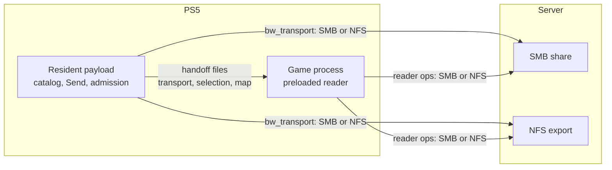

# NFS source design

Status: proposal. Nothing here is implemented. Nothing here is console-tested.

## Goal

Add NFS as a second source transport beside SMB. A user can point Blackwire at an NFS export on a NAS or Linux server. Catalog, Send, Play and the in-game reader work the same as for an SMB share.

SMB stays the default. Existing SMB installs keep their bindings and receipts unchanged.

## Constraints found

- The PS5 kernel has no FUSE. No public work loads kernel code on current firmware. A kernel filesystem approach is not possible.
- No evidence the PS5 kernel includes the FreeBSD NFS client. Unconfirmed until tested with `nmount` and fstype `nfs`.
- Blackwire already works in user mode. A reader preloaded into the game process (`libSceAmpr.sprx`) intercepts Ampr reads and fetches bytes itself. NFS fits in the same place.
- libnfs (same author as libsmb2) has the same API shape: `nfs_open`, `nfs_pread`, `nfs_stat64`, `nfs_get_fd`, `nfs_which_events`, `nfs_service`. Library code is LGPL-2.1-or-later.
- Only firmware profile `0x13000040` (13.00) is qualified. Every lifecycle gate matches it exactly. Other firmware refuses Play, Close, Uninstall and reader preload.

## Architecture



One transport interface is used in two places:

- The resident, for catalog listing, preparation copy, container metadata and admission checks.
- The in-game reader, for streamed reads during play.

The same NFS module compiles into both. The reader copy is built without threads and with private libc symbols renamed, as libsmb2 is today.

## Decision: transport inside the reader

Two designs were compared for the game-side path.

| | Reader transport (chosen) | Resident proxy over loopback |
| --- | --- | --- |
| Change size | Ops table over 24 call sites in `reader/preload/source.c` | New listener, wire protocol, session life cycle |
| Game depends on resident | No | Yes. Resident death fails every read. |
| Peer authentication | Not needed | TCP gives no peer pid. Needs a new token scheme. |
| Cold read latency | 3 LAN round trips | 3 LAN round trips plus loopback and 2 copies |
| SMB password on disk | Stays, SMB only | Removed |
| NFS privileged source port | Game process probably cannot bind below 1024 | Resident probably can |

Why: smaller change, no new runtime dependency, no new authentication problem.

Fallback: switch to the proxy if the console test shows the game process cannot reach NFS with common export settings.

## Transport interface

Draft header: [nfs-design-bw_transport.h](nfs-design-bw_transport.h). Not compiled.

- `bw_stat` replaces `struct smb2_stat_64` in all identity checks. Fields: type, ino, size, mtime, mtime_nsec, ctime, ctime_nsec. Type values match `SMB2_TYPE_*` because they are hashed.
- `bw_tp_error` replaces raw NT status in callers. Classes include missing, denied, unavailable, too large, changed and transport. The raw code is kept for diagnostics.
- `bw_transport_ops`: stat, open (no-follow, directory, file), fstat, pread, close, list, max_read, set_guard, last_status, destroy.
- `bw_source_ops` keeps today's `bw_source_smb_*` API. `library/source_smb.c` stays behind it unchanged. NFS gets `source_nfs.c`.
- `bw_transport_connect(cfg, profile, timeout, ...)` replaces 5 duplicated resident connect sites. Profiles keep per-site SMB security modes, which a test pins today.

## Identity

Installed games are bound by hashes that include SMB metadata. These must not change.

- SMB keeps `BWBIND01` and every existing hash domain byte for byte.
- NFS uses `BWBIND02` with a length-prefixed `nfs`, server, export, source and title. Every later seal hashes the binding, so NFS gets separate domains everywhere.
- NFS identity uses fileid, size, mtime and ctime with nanoseconds. `dev` (fsid) stays out. It differs between v3 and v4 in libnfs.
- Moving the same files from SMB to NFS creates new games. They need a fresh Send. Receipt migration is out of scope.

## Configuration

`share.conf` gains keys. SMB files stay byte-identical, with no new line.

```text
transport=nfs
server=192.168.1.20
export=/volume1/PS5Games
export2=/volume1/Compressed
nfs_version=3
uid=1000
gid=1000
```

- A missing `transport` means SMB.
- NFS configs omit `share=` and `user=`. An older payload then refuses them instead of trying SMB.
- Exports start with `/`. No `..`, `\`, `:` or control characters. Export names compare case-sensitively.
- `POST /api/setup` gains `transport`, `nfsVersion`, `nfsUid` and `nfsGid`. `GET /api/state` gains `settings.transport` and `settings.nfsVersion`.
- The settings page gains an SMB or NFS switch. NFS hides the Windows username and password and shows `server:/export`.
- Two sources under NFS means two exports on one server, with the same version and uid/gid.

## libnfs

- Version: 8.0.1, CMake, static. Flags: `-DBUILD_SHARED_LIBS=OFF -DENABLE_NFS4_2=OFF -DENABLE_TLS=OFF -DENABLE_MULTITHREADING=OFF`. Fallback: 7.0.3.
- The PS5 SDK packages 5.0.3. It was moved from 6.0.2 back to 5.0.3 in January 2025, with no reason recorded. 5.0.3 lacks the readdir recursion and cookie-loop fixes against a malicious server.
- Likely port issue: since 6.0, a failed keepalive socket option is fatal. Be ready to make it non-fatal.
- NFS version: v3 by default. v4 for networks that allow only port 2049.
- libnfs v4 reads send `PUTFH+READ` without `GETATTR`. v4 gives no round-trip saving for identity checks without a libnfs change.
- Defaults are a hard mount that retries forever. Blackwire must set `retrans=0` and a timeout, so failures surface.
- Timeouts report `-EINTR`, not `-ETIMEDOUT`. Map them to the transport class.
- libnfs always tries to bind a source port in 512 to 1023 first. It falls back to an ephemeral port silently.
- Disable the directory cache (`nfs_set_dircache(nfs, 0)`) for identity work.
- `nfs_stat64` and `nfs_open` follow symlinks. The NFS backend must refuse links, devices, sockets and FIFOs from READDIRPLUS attributes and never resolve through a link.

## Error guidance

| Failure | Message direction |
| --- | --- |
| Mount: export not found | Export path not found on the server |
| Mount: access refused | Server refused this console. Check allowed hosts and the `insecure` option. |
| Read: access refused | File permission for the configured uid/gid, or root squash |
| Timeout | Check ports 111, mountd and 2049 for v3, or 2049 for v4 |
| Stale handle | The source changed. Refresh the library. |

## Security

- NFSv3 with AUTH_SYS has no password. The server trusts the uid the client claims and restricts by client IP.
- Users should export read-only and allow only the console's IP.
- Many Linux and NAS exports need `insecure`, because the client may use a source port above 1023.
- The LAN HTTP API currently gives its action token to any LAN client. Fix that before or with the NFS settings, so new settings do not sit behind the same weakness.

## Plan

Each step is a separate pull request. Steps before NFS change no behaviour and are proved by the existing host tests and new golden tests.

| Step | Change | Proof |
| --- | --- | --- |
| 0a | HTTP hardening: Host and Origin checks, request deadline, frame headers, token on refresh | Host tests |
| 0b | Firmware profile table, 13.00 entry only | Host tests, same refusals |
| 0c | 12.40 profile entry | Console capture with `tools/fw-probe`, then a 12.40 test run |
| 1 | `bw_stat` and golden hash vectors captured on main | Golden tests |
| 2 | `bw_tp_error` mapping | Existing diagnostic tests byte-equal |
| 3 | Resident connect factory with profiles | Connect wrapper test |
| 4 | `bw_transport_ops` with SMB for container, prepare copy and filemap | Existing compressed and copy tests |
| 5 | `bw_source_smb` renamed to `bw_source` behind `bw_source_ops` | Source batch and namespace tests |
| 6 | Reader ops table in `reader/preload/source.c`, SMB only | `tests/reader/source_test.c` unchanged |
| 7 | `transport=` key in `share.conf` and the reader handoff | Old files parse and write back identically |
| 8 | Reader build takes several private archives | Symbol import check |
| 9 | libnfs vendored and built for resident and reader | Build pins, licence notices |
| 10 | NFS transport and source for the resident | `nfs_*` fakes, shared neutral tests |
| 11 | NFS reader ops | Reader fakes |
| 12 | Settings API and UI | `tools/test_ui.py` |
| 13 | Console test matrix and docs | Console results |

Reconnect after a network drop is a separate proposal. Today the reader never retries (`source.h`: "No retry"). Changing that changes a stated guarantee. It should be discussed upstream first.

## Console tests

On 12.40 after step 0c, then for NFS:

1. Resident: mount an NFS export, list, stat and read one file.
2. Resident: source port used. Export with `secure`, then with `insecure`.
3. Game process: the same connect and read from the preloaded reader.
4. Send to Ready from an NFS folder source and an NFS compressed image.
5. Play to menu and to gameplay. Record preparation, menu and gameplay separately.
6. Server restart and network pull during play. Expect a clean error, not a hang.
7. Throughput against the same game on SMB.

## Open questions

- Which server the first tester uses: NAS model, Linux or Windows.
- How the LAN API should authenticate: console pairing, or only Host and Origin checks.
- Whether reconnect belongs in this work.
- Whether `getservbyport`, `dup2`, `TCP_KEEP*` socket options and low-port `bind` work inside the game process.
- Whether the kernel NFS client exists. Cheap to test once a probe can be built.
